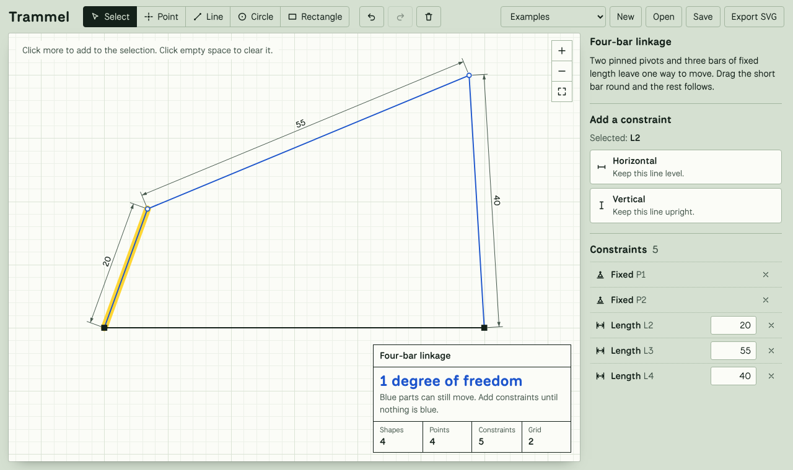

# Trammel

A 2D constraint sketcher that runs in the browser. Draw roughly, then add rules such as "these lines are parallel" or "this side is 40 long", and the geometry rearranges itself to obey them.



A trammel is a beam compass: a bar with two sliding points, used to set out exact distances. The word also means a restraint. Both meanings fit.

## What it does

Most drawing programs record where things are. A constraint sketcher records what must be true about them and works out where they have to be. This is how the sketch mode of every parametric CAD program works. Trammel is a small, readable implementation of that idea, and it keeps the state of the sketch on show the whole time.

- **Draw** points, lines, circles and rectangles.
- **Constrain** them with 13 kinds of rule: coincident, horizontal, vertical, fixed, distance, parallel, perpendicular, equal length, point on line, point on circle, radius, tangent and equal radius.
- **Drag** anything that is still free. The rest of the sketch follows, and every constraint stays true while it moves.
- **See how much freedom is left.** The title block counts the degrees of freedom. Parts that can still move are drawn blue, and parts that are fully decided are drawn in ink.
- **Find contradictions.** If constraints cannot all be true, Trammel leaves the geometry alone and marks in red the ones that are fighting. Constraints that add nothing are flagged as already implied.
- **Undo and redo** every edit, with a whole drag counting as one step.
- **Save and open** sketches as readable JSON, and **export** the geometry as SVG.
- **Five examples**, including a linkage you can crank and a triangle that cannot exist.

It works in light and dark mode and at phone width.

## Try it

```sh
npm install
npm run dev
```

Then open the address it prints.

1. Trammel opens on a four-bar linkage. The title block says **1 degree of freedom**. Drag the top of the short bar on the left and the other bars follow.
2. Click the short bar to select it, then click **Vertical** in the panel. The title block changes to **Fully constrained** and nothing is blue any more.
3. Open **Examples → Impossible triangle**. Its sides are 40, 30 and 80, which cannot close. The three lengths are marked in red. Change the 80 to 50 and it solves into a right angle.
4. Click **New**, press `R`, and click two corners to draw a rectangle. Select a side, click **Length**, and type a number.

## What the colours mean

| Colour           | Meaning                                                  |
| ---------------- | -------------------------------------------------------- |
| Blue             | Can still move. Something about it is undecided.         |
| Ink              | Pinned down. The constraints decide exactly where it is. |
| Red              | Part of a contradiction.                                 |
| Yellow highlight | Selected, or pointed at in the constraint list.          |
| Square point     | Fixed in place.                                          |

## Keyboard

| Key                        | Action                                                          |
| -------------------------- | --------------------------------------------------------------- |
| `V` `P` `L` `C` `R`        | Select, Point, Line, Circle, Rectangle                          |
| `Esc`                      | Finish drawing, then return to Select, then clear the selection |
| `Delete` or `Backspace`    | Delete the selection                                            |
| `Ctrl+Z`                   | Undo                                                            |
| `Ctrl+Shift+Z` or `Ctrl+Y` | Redo                                                            |
| `Ctrl+S`                   | Save                                                            |
| `F`                        | Fit the sketch to the view                                      |
| Mouse wheel                | Zoom                                                            |
| Drag on empty space        | Pan                                                             |

On a Mac, use `Cmd` in place of `Ctrl`.

## Commands

| Command                | What it does                               |
| ---------------------- | ------------------------------------------ |
| `npm run dev`          | Start the development server               |
| `npm test`             | Run the test suite once                    |
| `npm run test:watch`   | Run tests on every change                  |
| `npm run typecheck`    | Check types without building               |
| `npm run build`        | Build the static site into `dist/`         |
| `npm run preview`      | Serve the built site locally               |
| `npm run format`       | Format every file with Prettier            |
| `npm run format:check` | Check formatting without changing anything |

Node 22.12 or newer is needed.

## How it works

Every point contributes two numbers (x and y) and every circle one (its radius). Every constraint is one or two equations over those numbers that must equal zero. Solving a sketch means finding numbers that zero all the equations at once while moving as little as possible from where things were drawn.

Trammel does this with the Levenberg-Marquardt method, using derivatives written out by hand for every constraint. Counting freedom is a separate step: the number of independent equations is found with linear algebra, and whatever is left over is how many ways the sketch can still move.

[docs/ARCHITECTURE.md](docs/ARCHITECTURE.md) explains the solver, the freedom count, how conflicts are found, and the trade-offs made.

## Project layout

```
src/core/       The engine. Plain TypeScript, no DOM, no dependencies.
  types.ts        Entities, constraints and the Sketch type
  sketch.ts       Pure editing operations
  equations.ts    Each constraint as equations with derivatives
  solver.ts       The constraint solver, and dragging
  analysis.ts     Degrees of freedom, redundancy, conflicts
  catalogue.ts    Which constraints fit which selection
  io.ts           Save, load with validation, SVG export
  history.ts      Undo and redo
src/examples/   The built-in sketches
src/ui/         The React interface
tests/          Unit and property tests for the core and the view maths
docs/           Architecture notes and the screenshot
```

## Known limits

These are the honest edges of this version. Each has a place in the roadmap.

- **Size.** Dragging stays smooth up to roughly 60 points. Past about 100 points each drag step takes over a tenth of a second, because the whole sketch is solved as one dense system.
- **One conflict freezes dragging.** While any constraints contradict each other, nothing can be dragged, even parts that are unrelated to the conflict.
- **Tangent lines that end on the circle** solve correctly but slowly. A point that is both on a circle and on a tangent to it is a double root, which the solver approaches in many small steps.
- **Shapes.** There are no arcs, ellipses or splines yet, and no angle dimension.
- **Drawing needs a pointer.** The panel and the constraint list work from the keyboard, but placing and selecting shapes on the sheet needs a mouse, trackpad or touch. Pinch-to-zoom is not implemented: use the zoom buttons on touch screens.
- **Dimension and badge placement** is automatic and can overlap in crowded sketches.

## Roadmap

[ROADMAP.md](ROADMAP.md) lists the planned work in seven stages, with an hour estimate for every task.

## Privacy

Trammel runs entirely in your browser. There are no accounts, no server, no analytics and no network requests after the page loads. The typeface is bundled with the site rather than fetched from a font service. Sketches leave your machine only when you save or export a file yourself.

## Troubleshooting

**`npm install` fails with "Cannot read properties of null (reading 'edgesOut')".** This is a bug in npm 10 that is triggered by the optional peer dependencies of the build tools. The `.npmrc` in this repository sets `legacy-peer-deps=true`, which avoids it. If you see the error, check that file is present.

## Contributing

See [CONTRIBUTING.md](CONTRIBUTING.md). It includes a step-by-step guide to adding a new kind of constraint.

## Licence

[MIT](LICENSE) © 2026 Jamie Mason-Wright
